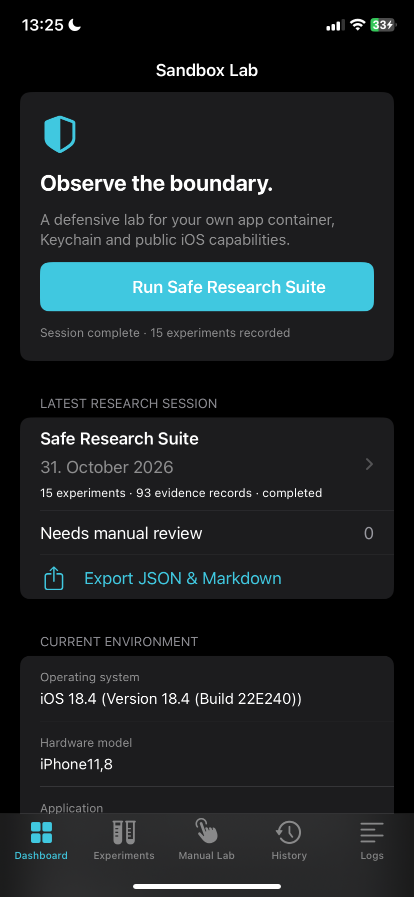
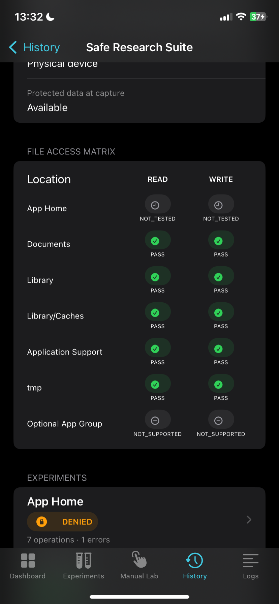
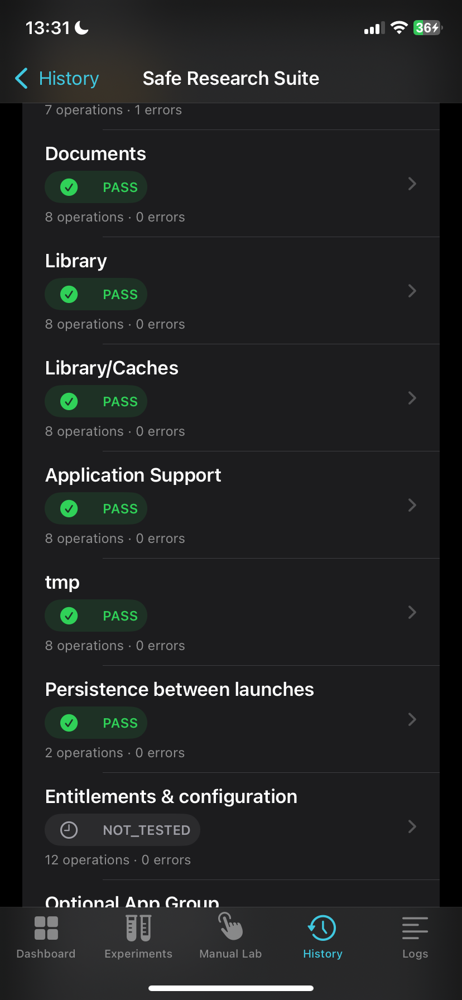
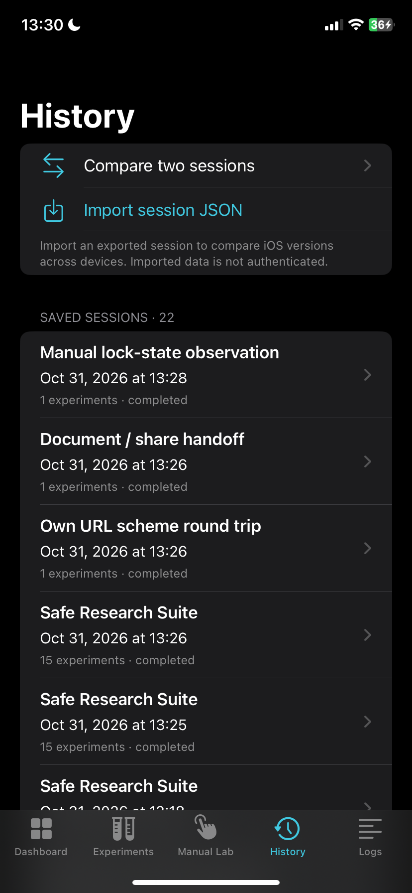
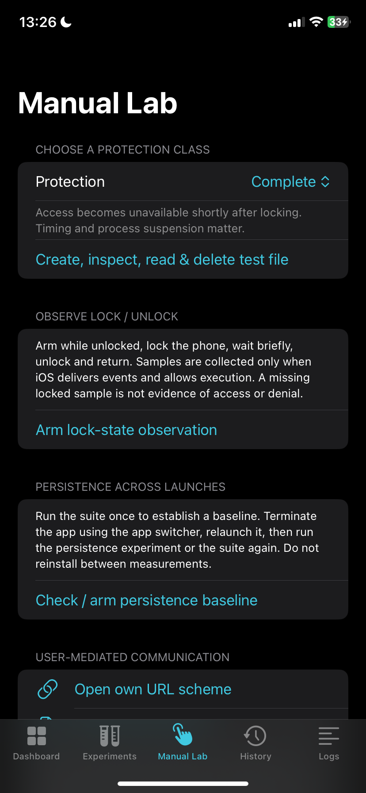

# Device run: iPhone XR · iOS 18.4 · 2026-10-31

These are real sessions recorded by SandboxResearchLab on a physical iPhone. Nothing here is synthetic. The interpretation is in [Research/2026-10-31-iphone-xr-ios18.4.md](../../Research/2026-10-31-iphone-xr-ios18.4.md).

| | |
| --- | --- |
| Device | iPhone XR (`iPhone11,8`), physical device |
| iOS | 18.4 (22E240) |
| App | SandboxResearchLab 1.0.0 with a development signature (`get-task-allow`). The installed bundle reports build `1.0.0`, while the `v1.0.0` release IPA declares build `1`, so the on-device signer rewrote it or a different package was installed. App sources at `v1.0.0` (`fcc0e05`) and `dc5997f` are identical. The exact binary provenance isn't verified. |
| Date | 2026-10-31, 12:17–13:30 CET |
| Data retrieval | USB from Linux: app container read via `house_arrest`, nothing exported through the share sheet |

## Procedure

1. **12:17–12:18**: the researcher ran each automatic experiment once on its own, then the full suite (session `01`). No persistence receipt existed yet, so these were the first sessions recorded by this installation.
2. **13:25**: the lab was terminated and relaunched from the host, then the suite was run again (`02`). This was the first launch that could verify the persistence marker.
3. **13:26**: the lab was terminated and relaunched again, and the suite was repeated (`03`).
4. **13:26**: Manual Lab → *Open own URL scheme* (`04`).
5. **13:26–13:27**: Manual Lab → *Share lab document*. On the device, **Copy** was chosen in the system share sheet (`05`).
6. **13:28–13:30**: Manual Lab → *Arm lock-state observation*. The phone was locked with the side button, about 15 s later it was unlocked, and the observation was stopped and saved (`06`).

The host started, stopped and operated the app through the developer disk image and the accessibility inspector ([Device-Automation.md](../../Documentation/Device-Automation.md)). The share-sheet choice and the lock/unlock were done by a person at the phone.

## Files

| Session | JSON | Report | Result |
| --- | --- | --- | --- |
| 01 Suite, first launch | [json](sessions/01-suite-baseline.json) | [md](reports/01-suite-baseline.md) | 74 PASS · 1 DENIED · 4 NOT_SUPPORTED · 13 NOT_TESTED |
| 02 Suite, after relaunch | [json](sessions/02-suite-after-relaunch-1.json) | [md](reports/02-suite-after-relaunch-1.md) | 76 PASS · 1 DENIED · 4 NOT_SUPPORTED · 12 NOT_TESTED |
| 03 Suite, after 2nd relaunch | [json](sessions/03-suite-after-relaunch-2.json) | [md](reports/03-suite-after-relaunch-2.md) | 76 PASS · 1 DENIED · 4 NOT_SUPPORTED · 12 NOT_TESTED |
| 04 Own URL scheme round trip | [json](sessions/04-own-url-round-trip.json) | [md](reports/04-own-url-round-trip.md) | 2 PASS |
| 05 Document / share handoff | [json](sessions/05-share-handoff.json) | [md](reports/05-share-handoff.md) | 2 PASS |
| 06 Lock/unlock observation | [json](sessions/06-lock-unlock-observation.json) | [md](reports/06-lock-unlock-observation.md) | 24 PASS |

None of the sessions contain a `NEEDS_REVIEW` or `ERROR` record. The single `DENIED` is the same operation every time: creating a directory directly in the app container root (see the research notes).

The reports were rendered from the JSON by the app's own `MarkdownReport` code (`Scripts/reportgen`). Every file passed the app's import validation (`SessionJSON.decode`) first.

The 16 single-experiment sessions from step 1 are kept privately. 15 of them have the same operation and result sequence as the matching experiment in `01`. The single persistence run differs only because it created the baseline, which the suite later saw as "baseline exists from this launch".

## Comparisons

Generated with the app's `SessionComparison` (including the error-comparison fix from this run):

- **01 → 02**: no context differences. Two changed operations: `persistence.launch / PERSISTENCE` NOT_TESTED → PASS, and `ARM_BASELINE` absent → PASS. That is exactly the expected effect of the first relaunch.
- **02 → 03**: no context differences, **0 changed operations**.

Before the fix, every pair also listed `files.home / DIRECTORY_CREATE` as "error changed", because the error text contains the run's random directory name. See finding 7 in the research notes.

## Redaction

The published JSON and Markdown differ from the raw device files in two substitutions only:

- the app's data-container UUID → `APP-DATA-CONTAINER`
- the signing team identifier → `TEAMID`

Everything else, including timestamps, random session/launch IDs, results, errors and attribute dumps, is unchanged. The unredacted originals are kept outside Git in `Research/Private/`. The device name and the list of other installed apps aren't part of any session. Share-sheet screenshots were left out because they show the phone's installed apps.

## Screenshots

| | | |
| --- | --- | --- |
|  |  |  |
| Dashboard after suite run `02` | File-access matrix of `03` | Experiment results of `03` |
|  |  | |
| History with all 22 sessions | Manual Lab | |
